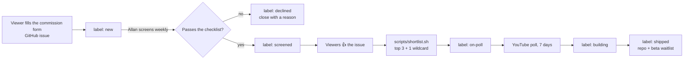

# How commissions get in and get picked

Curate first, then vote on a short list, and keep a veto. Open, unlimited lists go stale. Open votes get taken over by joke or hostile entries.

## Labels

| Label | Meaning |
|---|---|
| `commission` | Every submission. Added by the form. |
| `new` | Not screened yet. Added by the form. |
| `screened` | Passed the checklist. It can go on a poll. |
| `wildcard` | A joke or odd idea that is safe to build. One per poll. |
| `on-poll` | In the current YouTube poll. Remove it when the poll closes. |
| `software` / `hardware` | Build type. |
| `needs-funding` | A larger hardware build. The creator funds it, or it waits for a pre-sale. |
| `declined` | Did not pass. Close the issue with a one-line reason. |
| `building` | Won the poll. In progress. |
| `shipped` | Done. Link the video and the `bto-<name>` repo. |

Create them once with `scripts/setup-labels.sh`.

## Screening checklist (once a week, 15 minutes)

A commission is `screened` only if all of these are true:

- [ ] **Buildable** in an 8-hour time box (software), or in one month (hardware).
- [ ] **Legal and safe.** It breaks no site's terms. It does not scrape where scraping is not allowed. It is not for children 12 and under (hardware). It has no lithium battery (early hardware).
- [ ] **Someone uses it on day one.** The submitter has a real use for it.
- [ ] **Not a duplicate.** If it is, close it and link the original.
- [ ] **Fits the funding rule.** Small hardware, or the creator has said they can fund a larger build.

## Voting

- Viewers vote with a 👍 on the GitHub issue. Comments like "+1" do not count. One account, one vote.
- `scripts/shortlist.sh` lists the top `screened` commissions by 👍 count and shortens each to 65 characters for a YouTube poll.
- The final poll is a YouTube post poll with 4 options: the top 3 plus 1 `wildcard`. It runs 7 days.
- The poll post says: "I keep a veto. The poll is advice."
- Never tie the vote to likes, subscribes, or payment (YouTube contest rules).

## Later

When there are regular voters, move to a Discord or a Fider board. Keep the same labels and the same checklist.
